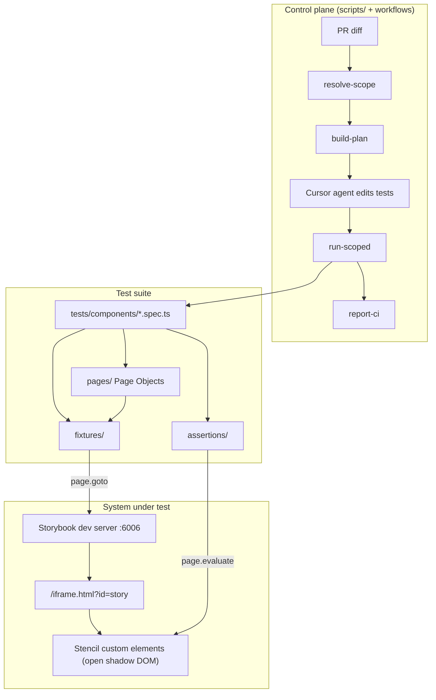
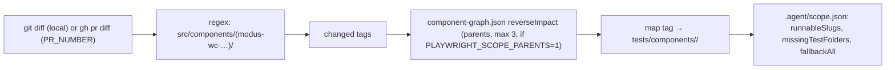
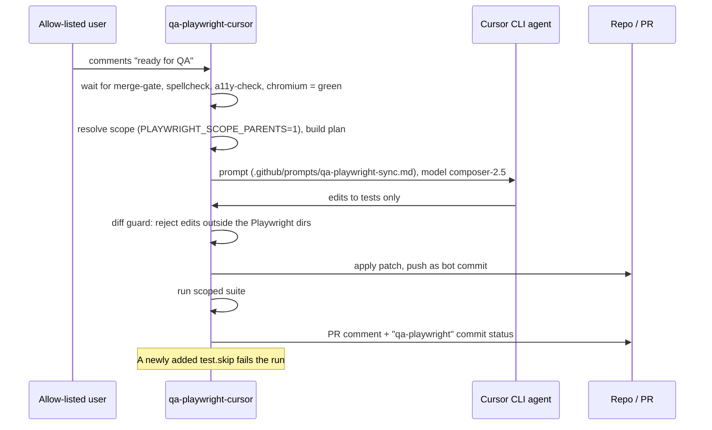

# Modus Web Components — Playwright Automation: Architecture

| | |
| --- | --- |
| **Status** | For architecture / peer review |
| **Scope** | `playwright_automation/` plus the root scripts, workflows, prompt and graph it depends on |
| **Verified against** | Repository HEAD `7c82097`, plus a local baseline run (60 passed, chromium, serial, about 1.7 min) |
| **Companion** | [`ARCHITECTURE-REVIEW.md`](./ARCHITECTURE-REVIEW.md) (findings and code-level refinements) |

Every statement below was taken from the code or from a command run against it. Where something is **not** verified, it is labelled *unverified*.

---

## 1. Purpose and context

The package is a Playwright test suite for the Stencil-based `modus-wc-*` components in this repository. It does not test components in isolation. It loads each component through its **Storybook story** (`/iframe.html?id=<storyId>`) and asserts on the rendered result.

Two things live in the package:

1. **A test suite** (`tests/`, `pages/`, `fixtures/`, `assertions/`).
2. **A control plane** (`scripts/`, `specs/`, and the `.github` workflows and prompt) that works out which components a pull request touched, writes a test plan for them, asks an LLM agent to write or update tests, and runs the scoped suite.

### Tech stack (from `package.json` and the lockfile)

| Tool | Declared | Locked |
| --- | --- | --- |
| `@playwright/test` | `^1.51.0` | 1.64.1 |
| `@axe-core/playwright` | `^4.10.2` | 4.14.0 |
| `tsx` (runs the scripts) | `^4.19.3` | n/a |
| `typescript` | `^5.8.2` | n/a |
| Storybook (root) | 8.6.19, `@storybook/web-components-vite` | n/a |
| Components | Stencil, tags `modus-wc-*` | n/a |

---

## 2. Repository and folder structure

```
playwright_automation/
├── playwright.config.ts          Runner configuration (projects, reporters, web server)
├── package.json / package-lock   Own dependency set (separate from the root)
├── tsconfig.json
├── README.md                     Human-facing guide (partly stale, see §10)
├── SPIKE-REPORT-1449.md          Go / no-go report for the spike (issue #1449)
├── ARCHITECTURE.md               This document
├── ARCHITECTURE-REVIEW.md        Review findings and refinements
│
├── fixtures/                     Plain helper functions (not Playwright `test.extend` fixtures)
│   ├── storybook.ts              URL builder, readiness wait, property sync, reset
│   ├── a11y.ts                   axe-core runner
│   ├── showCodeFixture.ts        Storybook docs "Show code" vs canvas parity
│   └── themes.ts                 The six theme IDs and the globals query
│
├── pages/                        Page Objects
│   ├── base.page.ts              Abstract BaseStorybookPage
│   ├── logo.page.ts              + LOGO_STORY_IDS
│   ├── switch.page.ts            + SWITCH_STORY_IDS
│   ├── navbar.page.ts            + NAVBAR_STORY_IDS   (added by the QA bot)
│   └── table.page.ts             + TABLE_STORY_IDS    (added by the QA bot)
│
├── assertions/                   Reusable assertion helpers
│   ├── css-token.ts              CSS custom property / computed-style checks
│   ├── events.ts                 Custom-event arm-then-act assertions
│   ├── performance.ts            Wall-clock budget helpers
│   └── svg-geometry.ts           Logo SVG viewBox constants
│
├── tests/components/<name>/      Specs, one folder per component
│   ├── logo/    stories, props, a11y, css, shadow-dom, show-code, performance   (7 files)
│   ├── switch/  stories, props, a11y, css, shadow-dom, show-code, performance   (7 files)
│   ├── navbar/  stories, props, a11y                                            (3 files)
│   └── table/   stories, props, a11y                                            (3 files)
│
├── specs/                        Generated test plans (Markdown), one per changed component
│   ├── README.md
│   └── logo.md, navbar.md, table.md
│
├── scripts/                      Control plane (TypeScript run with tsx, one `.mjs`)
│   ├── resolve-scope.ts          PR diff → changed components → graph parents → runnable folders
│   ├── build-plan.ts             Writes specs/<slug>.md
│   ├── apply-plan.ts             Applies a plan to spec files (removes tests, adds test.skip stubs)
│   ├── coverage-audit.ts         Checks that plan rows have matching tests
│   ├── run-scoped.ts             Runs Playwright for the scoped folders only
│   ├── agent-qa.ts               scope → plan → run-scoped, in one command
│   ├── report-ci.mjs             Builds the PR comment from JUnit + scope + sync notes
│   └── lib/                      component-graph, git-context, master-sheet, paths, spec-index
│
└── .agent/                       Generated at run time (scope.json, master-sheet.csv, qa-sync-notes.md, ci-sync/) — gitignored
```

### Files outside the package that it depends on

| Path | Role |
| --- | --- |
| `package.json` (root) | Scripts: `test:playwright`, `test:playwright:scoped`, `test:playwright:browsers`, `agent:scope`, `agent:plan`, `agent:audit`, `agent:apply`, `agent:qa`, `report:html`, `storybook:start`, `build:ci`, `build:graph` |
| `docs/component-graph/component-graph.json` | Component dependency graph. Edge kinds `composes`, `slot`, `hosts`; a `reverseImpact` map (parents of each component) |
| `.github/workflows/playwright.yml` | Runs the suite on PRs, nightly and on demand |
| `.github/workflows/qa-playwright-cursor.yml` | "ready for QA" flow: agent writes tests, then runs them |
| `.github/workflows/qa-approval.yml` | Environment approval gate (`qa-review`) |
| `.github/prompts/qa-playwright-sync.md` | Prompt given to the Cursor CLI agent |
| `.github/CODEOWNERS` | Covers `/playwright_automation/` |
| `.github/workflows/component-graph-check.yml`, `merge-gate.yml`, `a11y-check.yml`, `spellcheck.yml` | Neighbouring checks. `merge-gate`, `spellcheck`, `a11y-check` and the `chromium` job are the required checks the QA flow waits for |

### Per-file responsibilities (key files)

| File | Responsibility |
| --- | --- |
| `fixtures/storybook.ts` | `storyUrl()` builds `/iframe.html?id=…&args=k:v;k:v&globals=theme:<id>`. `waitForCustomElement()` waits on `customElements.get` / `whenDefined`. `syncHostProperty()` / `readHostProperty()` write and read DOM properties on the host. `resetInteractionState()` sets the viewport and moves the mouse. `getDocumentTheme()` reads the theme off `<html>`. |
| `fixtures/a11y.ts` | `runAxeOnStory()`: runs axe with tags `wcag2a, wcag2aa, wcag21a, wcag21aa`, scoped to the host via `include()`. |
| `fixtures/showCodeFixture.ts` | Opens the docs page, clicks "Show code", reads the first visual, and compares docs and canvas size (2 px tolerance). |
| `fixtures/themes.ts` | `MODUS_THEMES` (hard-coded list) and `themeGlobalsQuery()`. |
| `pages/base.page.ts` | `host` locator, `slot(name)` (`[slot="name"]` anywhere under the host), `gotoStory()`, `syncProp()`, `ensureProp()`. Subclasses add component locators. |
| `assertions/css-token.ts` | `readCssCustomProperty`, `expectCssToken`, `expectBorderRadiusMatchesHostToken`, `expectColorMatchesTokenOrRgbOklch`, `expectComputedMatchesHostToken` (declared, unused). |
| `assertions/events.ts` | Installs a listener that pushes into `window.__modusEventHits`, runs an action, then polls the array. Has a shadow-host variant. |
| `assertions/performance.ts` | Measures wall-clock time against budgets from env vars. |
| `scripts/resolve-scope.ts` | Orchestrates scope resolution and writes `.agent/scope.json` (see §6). |
| `scripts/report-ci.mjs` | Reads `reports/results.xml`, `scope.json` and sync notes; emits the PR comment body. |

---

## 3. Architecture overview



### Layering rules the code follows

1. **Specs** contain the scenarios and the `expect` calls. They talk to the page through Page Objects and helpers.
2. **Page Objects** own locators and story IDs. They extend one abstract base.
3. **Fixtures** are stateless functions that take a `Page`. There is **no** `test.extend` anywhere, so Playwright's fixture lifecycle is not used.
4. **Assertions** are plain `async` functions that call `expect` internally.
5. **Control-plane scripts** never import test code. They read spec files as text.

---

## 4. Spec taxonomy and conventions

| Category (file) | What it asserts |
| --- | --- |
| `stories` | Each story renders; the host is attached and visible; basic structure. |
| `props` | Property to DOM effects; state changes; events (`inputChange`, and others per component). |
| `a11y` | axe-core violations (WCAG 2.0/2.1 A and AA); ARIA snapshots; Switch keyboard and focus checks. |
| `css` | Design-token resolution across the six themes. |
| `shadow-dom` | Behaviour inside a `*-shadow-host` parent story that wraps the component in another shadow root. |
| `show-code` | Docs "Show code" snippet and canvas parity. |
| `performance` | Wall-clock budgets for initial render and for an update. |

Conventions seen in the code:

- Test titles carry the tag `@master`; the config selects tests with `grep: /@master/`.
- Titles follow `should <do something> when <condition>` and many carry a bracketed ID (for example `[LOGO-CSS-1]`).
- Story IDs come from the `*_STORY_IDS` constants, although several specs still hard-code them.
- Theme coverage loops over `MODUS_THEMES`: `modus-modern-light`, `modus-modern-dark`, `modus-classic-light`, `modus-classic-dark`, `connect-light`, `connect-dark`.

---

## 5. Shadow DOM and Web Component handling

| Concern | Mechanism | Where |
| --- | --- | --- |
| Reaching elements inside an **open** shadow root | Playwright CSS locators pierce open shadow roots, so `host.locator('input.modus-wc-toggle')` works without extra code. | Page Objects |
| Slotted content | `BaseStorybookPage.slot(name)` locates `[slot="name"]` anywhere below the host. This is needed because light-DOM hosts such as the navbar re-parent slotted nodes. | `base.page.ts` |
| Component readiness | `customElements.get(tag)` / `whenDefined(tag)`, then `host.waitFor`. | `fixtures/storybook.ts` |
| Nested shadow roots | `ShadowDomParent` stories (`*-shadow-host`) wrap the component in another shadow root; a few checks use `page.evaluate` and `shadowRoot.querySelector` by hand. | `events.ts`, `*/shadow-dom.spec.ts` |
| Props not settable by URL | `syncProp` / `syncHostProperty` set the DOM property after navigation and verify it. See §10, item 1. | `fixtures/storybook.ts`, `base.page.ts` |
| Events | Listener armed before the action, then polled. Reads `window.__modusEventHits`. | `assertions/events.ts` |
| CSS tokens | Read via `getComputedStyle`; one helper falls back to inspecting stylesheet source text. | `assertions/css-token.ts` |

Limit: all of this assumes shadow roots are **open** (Stencil's default). A closed root would not be reachable by locators.

---

## 6. End-to-end execution workflow

### 6.1 Configuration (`playwright.config.ts`)

| Setting | Value |
| --- | --- |
| Test dir | `./tests` |
| Selection | `grep: /@master/` |
| Parallelism | `fullyParallel: false`, `workers: 1` |
| Retries | `CI ? 1 : 0`; `forbidOnly` in CI |
| Reporters | `list`, `html` (to `reports/`), `junit` (`reports/results.xml`) |
| Artefacts | Trace, screenshot and video retained on failure |
| Viewport | 1280 × 720 |
| Projects | `chromium`, `firefox`, `webkit` |
| Web server | Local: `npm run storybook:start`. CI: `npx storybook dev -p 6006 --ci --no-open --exact-port`. `url` is hard-coded to `http://127.0.0.1:6006`. Skipped when `PLAYWRIGHT_SKIP_WEBSERVER=1` or `STORYBOOK_URL` points to a remote host. |

### 6.2 Environment variables

| Variable | Effect |
| --- | --- |
| `STORYBOOK_URL` | Remote Storybook; disables the local web server |
| `PLAYWRIGHT_SKIP_WEBSERVER` | `1` disables the web server |
| `PLAYWRIGHT_PROJECT` | Project used by `run-scoped` (default `chromium`) |
| `PLAYWRIGHT_STORY_BUDGET_MS` | Initial render budget (default 8000) |
| `PLAYWRIGHT_UPDATE_BUDGET_MS` | Update budget (default 1000) |
| `PLAYWRIGHT_SCOPE_PARENTS` | `1` adds graph parents (capped at 3) to the scope |
| `PR_NUMBER` | Drives `gh pr diff` and issue lookup in the scripts |
| `MASTER_SHEET_CSV` | Path to the master-sheet CSV used by `build-plan` |
| `CI` | Changes retries, `forbidOnly`, web-server command |

### 6.3 Local run

1. `npm run test:playwright` runs the whole `@master` set on the configured project(s). The config starts Storybook on port 6006 and waits for the URL.
2. `npm run test:playwright:scoped` (or `agent:qa`) runs only the components in scope.
3. `npm run report:html` opens the HTML report.

### 6.4 What a single test does

1. Build the URL with `storyUrl(id, args, theme)`; `page.goto`.
2. `waitForCustomElement` and `host.waitFor`.
3. If an enum or select prop is needed, `syncProp` writes it to the DOM.
4. Interact and assert (web-first `expect`, or `expect.poll` / `evaluate` for tokens and events).
5. On failure, Playwright keeps trace, screenshot and video.

### 6.5 Scope resolution (`resolve-scope.ts`)



- Tags with no `tests/components/<name>/` folder go to `missingTestFolders`. They are printed but **not** run.
- `fallbackAll` is set when scope cannot be resolved, so the full suite runs.

### 6.6 Plan pipeline

| Step | Output |
| --- | --- |
| `build-plan.ts` | `specs/<slug>.md`. Rows come from the master-sheet CSV, from existing tests (via `spec-index.ts`), or from archetype scenarios. Statuses: `DRAFT`, `READY`, `NEED CLARIFICATION`. |
| `apply-plan.ts` | Removes tests and adds `test.skip` stubs, from plan rows. |
| `coverage-audit.ts` | Compares plan rows with the test index. Skips `manual` rows and rows with automate `no`. |
| `run-scoped.ts` | `playwright test --project=<project> <folders…> <extra args>` |
| `agent-qa.ts` | `scope`, then `plan`, then `run-scoped` |
| `report-ci.mjs` | Markdown comment from JUnit, scope and sync notes |

### 6.7 CI

**`playwright.yml`**

| Trigger | What runs |
| --- | --- |
| Pull request to `main` | Chromium only, scoped tests |
| Nightly 02:30 UTC, manual dispatch | Chromium, Firefox, WebKit; unscoped |
| Artefacts | `playwright-report-<browser>`, kept 7 days |

Latest PR run (run `44533696367`, chromium): job about 4 min. Step times: install 59 s, build components 90 s, install browser 22 s, **tests 58 s**.

**`qa-playwright-cursor.yml` ("ready for QA")**



**`qa-approval.yml`**: the `qa-review` environment needs approval from `jewel-shajan` or `Kavin-Trimble`. CODEOWNERS covers `/playwright_automation/`.

### 6.8 Reporting

- **Console**: `list`.
- **HTML**: `reports/` (also `playwright-report-<browser>` artefact).
- **JUnit**: `reports/results.xml`, consumed by `report-ci.mjs`.
- **PR surface**: a comment with the result and a `qa-playwright` commit status.

---

## 7. Test coverage scope

Chromium baseline: **60 tests**, all passing, about 1.7 min with one worker.

Test counts per file (static `test()` calls; the two `css` files expand over 6 themes at run time):

| Component | stories | props | a11y | css | shadow-dom | show-code | performance | Total |
| --- | --- | --- | --- | --- | --- | --- | --- | --- |
| Logo | 4 | 8 | 3 | 6 (themes) | 2 | 1 | 3 | 27 |
| Switch | 3 | 5 | 6 | 6 (themes) + 1 | 3 | 1 | 2 | 27 |
| Navbar | 1 | 1 | 1 | none | none | none | none | 3 |
| Table | 1 | 1 | 1 | none | none | none | none | 3 |

Navbar and Table each have one generated "archetype" test per category (titles such as `should cover default stories for navbar [navbar-stories]`). I did not audit their bodies beyond the titles and the fact that they are 12 to 19 lines per file.

### Behaviours covered (from test titles)

| Area | Covered |
| --- | --- |
| Rendering | Logo: default canvas with role `img`, custom size classes, `ShadowDomParent`, autodocs page. Switch: default canvas with host and input, `ShadowDomParent`, autodocs page. |
| Props and states | Logo: `name`, `emblem`, `alt` to `aria-label`, default `aria-label` from `name`, emblem viewBox `0 0 32 32`, wordmark viewBox `0 0 106 32`, connect emblem, `developer_console` wordmark (`[tc:LOGO-PROPS-8]`). Switch: `size` (`lg` only), label `for` to input `id`, `aria-checked` true / false / mixed, disabled opacity and `aria-disabled`. |
| Events | Switch: `inputChange` on click and on Space; `inputFocus` / `inputBlur` on a focus cycle; operating the input inside the shadow boundary |
| Accessibility | axe on default and disabled Switch; axe on full-wordmark and emblem Logo; ARIA snapshot tests for Switch (`switch` role) and Logo (`img` role); focus-visible outline after Tab (Switch) |
| Theming | Six themes. Logo: fill tokens on host. Switch: `--rounded-badge` on host applied to the toggle, and not read from the document root. |
| Shadow DOM | Switch and Logo inside `*-shadow-host`; `data-theme` propagates into the shadow wrapper |
| Docs | "Show code" snippet contains the tag, with canvas parity (Switch, Logo) |
| Performance | Logo: ready budget, `name` change, `emblem` change. Switch: ready budget, `value` change. |

### Browsers

Chromium on every PR. Firefox and WebKit on the nightly and manual runs only.

---

## 8. Quality gates and merge flow

1. PR opens; `playwright.yml` runs scoped chromium tests.
2. A user comments `ready for QA`; the workflow waits for the four required checks.
3. The agent changes tests; the diff guard restricts the paths; the bot pushes a commit.
4. The scoped suite runs; the comment and `qa-playwright` status are posted.
5. `qa-approval` requires a named reviewer in the `qa-review` environment.
6. Per `SPIKE-REPORT-1449.md` §8, the `qa-playwright` status is not yet a required branch-protection check.

---

## 9. Dependencies

| Dependency | Why it matters |
| --- | --- |
| Storybook dev server | Every test navigates to it; a build that breaks Storybook breaks every test |
| Stencil build (`build:ci`) | Required before Storybook can render the components |
| `gh` CLI and `GH_TOKEN` | Scope resolution for PRs and issue lookup |
| `docs/component-graph/component-graph.json` | Source for parent scope; kept fresh by `build:graph` and `component-graph-check.yml` |
| Master-sheet CSV | Optional plan source; gitignored; provided through `MASTER_SHEET_CSV` |
| `CURSOR_API_KEY`, `QA_GITHUB_LOGINS` | Needed by the QA workflow |

---

## 10. Current limitations and gaps

Each item is tied to code or to a run. Severity and fixes are in the review document.

| # | Limitation | Evidence |
| --- | --- | --- |
| 1 | **Enum and select URL args are ignored by the stories.** Tests set those props through `syncProp` after load. The `args` query string gives a false impression that the arg pipeline is tested. | Probe run; `fixtures/storybook.ts`, `base.page.ts` |
| 2 | **Serial execution.** `workers: 1`, `fullyParallel: false`. Cause: the wall-clock performance tests fail under parallel load (4 workers: only the performance tests failed). Parallel functional run measured 46 s against 102 s serial. | Baseline and 4-worker runs; `config`, `performance.ts` |
| 3 | **Performance tests gate merges.** They use wall-clock budgets (`8000` ms render, `1000` ms update) inside the `@master` set. | `assertions/performance.ts` |
| 4 | **Coverage depth is uneven.** Navbar and Table have one generic test per category. No CSS, shadow-DOM, show-code or performance coverage for them. | §7 |
| 5 | **Components with changes but no test folder are not run.** They are printed in scope output only. A PR touching Badge or Content Tree gets a green check from Logo tests alone. | `scope.json` fields; `SPIKE-REPORT-1449.md` limit 3 |
| 6 | **Scope is detected from paths under `src/components/<tag>/` only.** Shared files (types, utils, styles) are not mapped to components. | `git-context.ts`, `tagsFromDiffPaths` |
| 7 | **PR runs are chromium only.** Firefox and WebKit run nightly. | `playwright.yml` |
| 8 | **axe runs on the default theme only** (default and disabled for Switch; two variants for Logo). axe tags stop at WCAG 2.1 AA, while the repo guidelines target WCAG 2.2. | `fixtures/a11y.ts`, `*/a11y.spec.ts` |
| 9 | **Switch tests pin `aria-checked=""` (checked), `aria-checked` absent (unchecked) and `aria-disabled=""`.** The test comment says "Boolean true is rendered as an empty attribute, not the string 'true'". The tests lock in that rendering, although an empty value is not a valid ARIA boolean. | `switch/props.spec.ts` lines 40–45, `switch/a11y.spec.ts` line 72 |
| 10 | **Tab-focus check never asserts focus**, and the "keyboard focus cycle" uses programmatic `.focus()`. | `switch/*.spec.ts` |
| 11 | **Generated Navbar and Table tests are shallow and their titles overstate them.** The a11y tests are titled "should pass axe on interactive state" but only analyse the default render. `navbar/props.spec.ts` ("cover public props for navbar") checks only the embedded Logo's `logo-name` and `condensed`; `table/props.spec.ts` checks the `density` and `hover` classes. | `navbar/*.spec.ts`, `table/*.spec.ts` |
| 11a | **Event tests do not check the payload.** `expectHostEventOnAction` only confirms the event fired; the `detail` (`target.checked`) is never read, so a click that fires `inputChange` without toggling would still pass. | `assertions/events.ts`, `switch/props.spec.ts` |
| 12 | **`tsc --noEmit` reports 6 errors** and CI has no typecheck step. | `tsc` run |
| 13 | **Plan tooling has defects.** `apply-plan` removal splits on `test(`, so deleting the last test in a file removes the closing braces; ID matching is by substring. `build-plan` never writes `remove` rows and its `conflicts` list is always empty, so `NEED CLARIFICATION` cannot occur. The issue lookup falls back to any `#N` and resolved to the PR itself in the generated plans (`Issue #8`). `agent:apply` is not used in CI. | `apply-plan.ts`, `build-plan.ts`, `git-context.ts` |
| 14 | **`run-scoped` always adds `--project=<default>`**, then appends extra args. The workflow also passes `--project=chromium`, so the flag appears twice; a different value would run two projects. | `run-scoped.ts`, `playwright.yml` |
| 15 | **`git-context` builds shell commands by string interpolation** (`execSync` with `PR_NUMBER`). | `git-context.ts` |
| 16 | **LLM-authored code runs in a job that holds write tokens.** The test step unsets `GH_TOKEN`, but the job has `contents: write` and `pull-requests: write`. | `qa-playwright-cursor.yml` |
| 17 | **No visual regression, no RTL or reduced-motion checks, no framework-wrapper (React, Angular, Vue) smoke tests, no Figma comparison.** | Absence from `tests/`; README "Out of this package" |
| 18 | **Documentation drift.** README reports 48 passed and Switch and Logo only. It references `.cursor/GOOGLE-MCP-SETUP.md` and the skill `playwright-pr-orchestrator`; neither exists. Generated plans also point at the missing skill. `SPIKE-REPORT-1449.md` limits 1, 2 and 4 are out of date. | File search |
| 19 | **Unverified:** whether the bot's push (made with the default `GITHUB_TOKEN`) triggers required checks on the new commit SHA. | Not tested |

### Facts checked and found *not* to be problems

- Kebab-case URL args such as `input-id` and `logo-name` match the story arg names.
- `playwright.yml` does resolve scope correctly in CI (checked in the run log).
- Generated `.agent/` files are gitignored.
